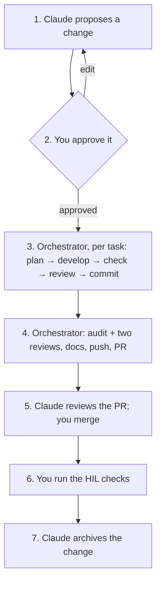

# Development Workflow

How a feature goes from idea to working firmware. Agent rules are in
[AGENTS.md](../AGENTS.md); this page is for the developer driving the agents.

## Roles

| Role | Who | Where | Owns |
| --- | --- | --- | --- |
| **Developer** | you | — | approvals, PR merges, hardware-in-the-loop (HIL) tests |
| **Spec planner** | Claude (Claude Code) | main worktree | OpenSpec changes, PR review, archive — [guide](../.claude/spec-planning.md) |
| **Orchestrator** | Qwen 3.8 27B (OpenCode) | one Orca worktree per change | carries a change from tasks to a PR — [definition](../.opencode/agents/orchestrator.md) |
| **Helpers** | Qwen, DeepSeek, Claude via LiteLLM | started by the orchestrator, one task each | plan, implement, review, audit, document — [.opencode/agents/](../.opencode/agents/) |

Small local models are fast but degrade with long contexts, so the process
keeps their inputs small: a self-contained `design.md`, one task per helper
run, and tools that print one line per step.

## The Loop



1. **Propose.** Ask Claude for a feature. It writes
   `openspec/changes/<change>/` (proposal, delta specs, design, tasks) and
   validates it.
2. **Approve.** Read `proposal.md` and the `design.md` Open Questions. Answer
   them, or approve.
3. **Apply.** Create an Orca worktree for the change, run
   `tools/opencode.sh` in it and ask: `Apply OpenSpec change <change-id>.`
   Follow it from the Orca board; it marks the worktree "needs you" when it
   stops.
4. **PR.** After every task, the orchestrator runs a security audit and two
   independent reviews, updates docs, pushes the branch and opens a PR whose
   body lists the HIL checks.
5. **Review and merge.** Claude reviews the PR against the design; you merge.
6. **HIL.** Flash and test on the rover using the PR's HIL checklist.
7. **Archive.** Claude runs `/openspec-archive-change`, merging the delta
   specs into `openspec/specs/` (the record of what the firmware does).

## Secrets

Agent configuration in the repo holds no secrets. `opencode.json` reads the
LiteLLM endpoint and key as `{env:LITELLM_BASE_URL}` and
`{env:LITELLM_API_KEY}`, which `tools/opencode.sh` loads from
`~/.config/litellm/obsidian.env`:

```
mkdir -p ~/.config/litellm
cp tools/obsidian.env.example ~/.config/litellm/obsidian.env
chmod 600 ~/.config/litellm/obsidian.env   # then fill in the values
```

`tools/check.sh` (step `secrets`) fails if any value from that file, or
anything shaped like a key, appears in the repo.

## Current Changes

| Change | Depends on | Was |
| --- | --- | --- |
| `add-xiao-foundation` | — | spec 001 |
| `add-atmega-foundation` | — | spec 002 |
| `add-uart-link` | both foundations | spec 003 |

`openspec list` shows progress; `openspec view` gives a dashboard. Feature
order: [roadmap.md](roadmap.md).

## Guardrails

- `tools/check.sh` is the definition of done for agents and CI alike.
- Each agent's permissions are in its front matter in `.opencode/agents/`; shared
  defaults in `opencode.json` (agents can't edit either). Only the
  orchestrator commits and pushes, and only to its change branch.
- Specs change only through a change you approve; `docs/hardware/` only when
  you confirm the wiring.
